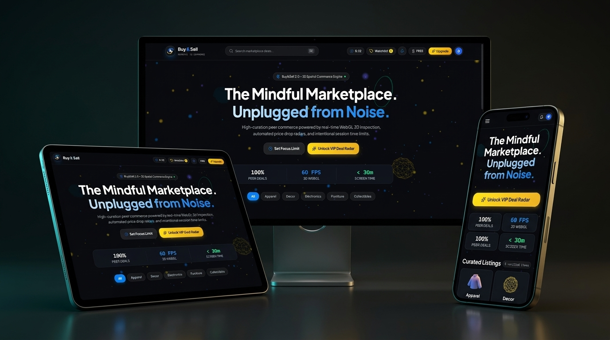

<div align="center">

# Buy&Sell • Mindful 3D Spatial Marketplace

<p align="center">
  <strong>Next-Generation Peer-to-Peer Commerce with Real-Time WebGL 3D Inspection & Mindful Digital Well-being</strong>
</p>

[](https://vitejs.dev/)
[](https://react.dev/)
[](https://threejs.org/)
[](https://tailwindcss.com/)
[](https://www.typescriptlang.org/)
[](https://render.com/)

<br />



</div>

---

## 📌 Overview

**Buy&Sell** (formerly *BuySellUnplugged*) is a high-curation peer-to-peer commerce platform redesigned from the ground up as a **3D spatial web experience**. It merges high-end luxury e-commerce aesthetics with intentional, mindful digital wellness. 

Instead of endless addictive scrolling, Buy&Sell empowers users with:
- **Spatial 3D Product Inspection:** Real-time 360° WebGL mesh rotation, PBR physical material shaders, and wireframe analysis.
- **Mindful Screen-Time Limits ("Focus Limit"):** An interactive radial chronograph where shoppers set daily or weekly browsing budgets to curb impulsive consumption.
- **Live Deal Radar:** Automated price drop thresholds and restock revisit schedulers.
- **Universal Mobile Ergonomics:** Floating native glass bottom dock, 2-column mobile marketplace grid, and smooth touch-screen 3D gesture controls.

---

## 🌐 Live Deployment & Repository

- **Live URL:** [https://buysellunplugged.onrender.com/](https://buysellunplugged.onrender.com/)
- **GitHub Repository:** [https://github.com/IsravelTECH/Buy-Sell](https://github.com/IsravelTECH/Buy-Sell)

---

## ✨ Key 3D & Spatial Features

### 1. Interactive 3D WebGL Background (`SpatialBackground.tsx`)
- Physically rendered particle constellation with floating obsidian crystal icosahedrons and glowing neon toruses.
- Real-time mouse and pointer velocity tracking with smooth spring camera parallax.
- Deep Void Obsidian color palette (`#08090C`) with additive bioluminescent lighting.

### 2. Real-Time 3D Product Inspector (`ProductInspector3D.tsx`)
- Full 360° orbit rotation with touch gesture support (`touch-action: none`).
- Procedural PBR materials tailored to each product category (aged moto leather, stoneware ceramic glaze, optical glass lens, vintage vinyl).
- Studio lighting toggle (Daylight, Tokyo Cyberpunk Neon, Ambient).
- Mesh wireframe inspection mode and auto-spin controls.

### 3. Spatial 3D Tilt Cards (`ProductCard.tsx`)
- Dynamic 3D card tilt tracking pointer coordinates (`perspective(1000px) rotateX(...) rotateY(...)`).
- Specular radial light sheen that reflects across the frosted glass card as the cursor glides over it.
- Live savings calculation and deal rating badges (`Super Deal`, `Fair Market`, `Rare Collectible`).

### 4. Mindful Focus Limit Cockpit (`FocusDrawer.tsx`)
- SVG radial progress ring visualizing real-time session duration.
- Customizable daily and weekly screen-time horizons (15m, 30m, 45m, 60m+).
- Live HUD timer ticking in the navigation header with Zen Mode notifications when limits are reached.

### 5. Interactive 3D Damascus Membership Token (`UpgradeModal.tsx`)
- Interactive 3D physical VIP card with mouse-reactive metallic Damascus foil sheen.
- Annual vs. monthly plan toggle with dynamic 20% discount calculations.
- Confetti celebration physics upon membership activation.

### 6. Mobile-First Ergonomics (`MobileBottomNav.tsx`)
- Native-style floating glass bottom dock (`Explore`, `Search`, `Focus`, `Watchlist`, `VIP`).
- Responsive 2-column mobile grid for high browsing velocity without visual clutter.
- Responsive bottom sheets with safe-area insets.

---

## 🛠️ Complete Tech Stack

| Layer | Technology | Purpose |
| :--- | :--- | :--- |
| **Frontend Framework** | **React 18.3** | Component hierarchy, hooks, state synchronization |
| **Language** | **TypeScript 5.7** | Type safety, strict interfaces for products and reminders |
| **3D Graphics Engine** | **Three.js (WebGL)** | Particle physics, PBR physical shaders, 3D meshes, orbital camera |
| **Build & Dev Tool** | **Vite 6.0** | Sub-second HMR, tree-shaking, production bundle minification |
| **Styling & FX** | **Tailwind CSS 3.4** | Utility-first styling, ultra-glassmorphism blur layers, custom gradients |
| **Icons & Brand** | **Lucide React** | Sleek geometric interface iconography |
| **Animation & Physics**| **Canvas Confetti** | Particle burst physics for VIP upgrades and achievements |
| **Typography** | **Plus Jakarta Sans** | Modern geometric sans-serif typeface |
| **State Persistence** | **Browser LocalStorage** | Offline session state, active reminders, user tiers, and watchlists |
| **Hosting & Cloud** | **Render (Static Site)** | Automated CI/CD deployments via `render.yaml` |

---

## 📂 Project Architecture

```
Buy-Sell/
├── Buy&Sell_commerce_responsive_3D.jpg       # Project Showcase Mockup Image
├── IMPLEMENTATION_PLAN.md                     # Architectural implementation roadmap
├── README.md                                  # Project documentation
├── render.yaml                                # Render Infrastructure-as-Code blueprint
├── package.json                               # Dependencies & build scripts
├── vite.config.ts                             # Vite config with relative base path ('./')
├── tailwind.config.js                         # Custom obsidian & neon design tokens
├── postcss.config.js                          # PostCSS Tailwind processor
├── tsconfig.json                              # TypeScript compilation settings
├── public/
│   ├── favicon.svg                            # Custom 3D neon exchange SVG favicon
│   └── icon.svg                               # High-res app icon
├── dist/                                      # Production-ready static build bundle
└── src/
    ├── main.tsx                               # Application entry point
    ├── App.tsx                                # Main application state & HUD coordinator
    ├── index.css                              # Glassmorphic utilities & custom scrollbars
    ├── data/
    │   └── products.ts                        # Normalized marketplace product database
    └── components/
        ├── 3d/
        │   ├── SpatialBackground.tsx          # Three.js star particles & floating prisms
        │   └── ProductInspector3D.tsx         # 360° interactive 3D WebGL product viewer
        └── ui/
            ├── Navbar.tsx                     # Header with real-time Focus HUD & logo
            ├── HeroSection.tsx                # 3D spatial headline & category ribbons
            ├── ProductCard.tsx                # Interactive 3D tilt cards with specular sheen
            ├── MobileBottomNav.tsx            # Floating glass mobile navigation dock
            ├── FocusDrawer.tsx                # Mindful screen-time manager
            ├── SearchModal.tsx                # Command+K floating search HUD
            ├── ReminderModal.tsx              # Price drop radar & deal scheduler
            ├── WatchlistDrawer.tsx            # Portfolio tracker with real-time total value
            ├── UpgradeModal.tsx               # 3D Damascus VIP membership token
            └── AuthModal.tsx                  # Social & credential authentication
```

---

## 🚀 Getting Started Locally

### Prerequisites
- **Node.js** (v18.0 or higher)
- **npm** (v9.0 or higher)

### Installation

1. **Clone the repository:**
   ```bash
   git clone https://github.com/IsravelTECH/Buy-Sell.git
   cd Buy-Sell
   ```

2. **Install dependencies:**
   ```bash
   npm install
   ```

3. **Start the local development server:**
   ```bash
   npm run dev
   ```
   Open your browser and navigate to `http://localhost:3000`.

4. **Build for production:**
   ```bash
   npm run build
   ```

5. **Preview production build locally:**
   ```bash
   npm run preview
   ```

---

## ☁️ Deployment Guide (Render)

When deploying to **[Render](https://render.com/)**, configure the static site with the following settings:

| Setting | Value |
| :--- | :--- |
| **Environment** | `Static Site` |
| **Build Command** | `npm install && npm run build` |
| **Publish Directory** | `dist` |

> **Note:** The included `render.yaml` automatically applies these settings if using Render Blueprints.

---

## 📄 License

This project is open-source and available under the **MIT License**.
